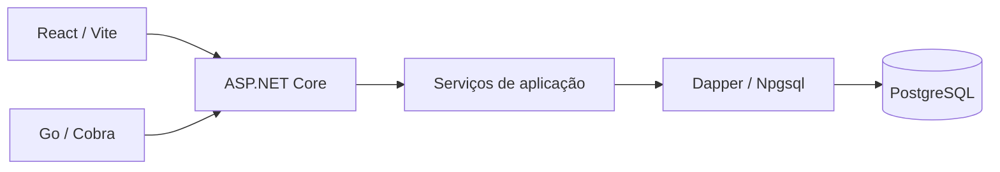

# Fio (Linkanban)

Acompanhe cada candidatura até a resposta — do primeiro envio à proposta.

Registre a vaga em segundos, mova o cartão conforme o processo anda e veja o que
está parado antes de virar silêncio. O produto existe para uma coisa que planilha
não faz bem: **não deixar processo morrer sem resposta**.

Monorepo com pnpm workspaces e Turborepo. O frontend é um SPA em **Vite + React 19**,
e o backend oficial é **ASP.NET Core 10 com Dapper + PostgreSQL**. A interface segue um sistema visual
documentado em [`docs/design/DESIGN.md`](docs/design/DESIGN.md). A identidade (nome,
símbolo, vocabulário e tom) está em [`docs/design/BRAND.md`](docs/design/BRAND.md) e a
especificação do produto em [`docs/design/PRODUCT.md`](docs/design/PRODUCT.md).

## O que o projeto entrega

- Quadro Kanban para acompanhar candidaturas e mudanças de etapa.
- Cadastro de empresas e vagas, com filtros e paginação na API.
- Follow-ups com data prevista, conclusão e registro do resultado.
- Visão de resumo e dashboard para acompanhar o andamento dos processos.
- CLI em Go para consultar e atualizar os mesmos recursos pelo terminal.

## Decisões técnicas que vale explorar

| Decisão | Por que ela importa | Onde ver |
|---|---|---|
| API dividida em apresentação, aplicação e infraestrutura | Separa contratos HTTP, regras de negócio e SQL | [Backend .NET](apps/api-dotnet/src) |
| Dapper com consultas explícitas | Mantém o acesso ao PostgreSQL próximo do SQL utilizado | [Repositórios](apps/api-dotnet/src/Fio.Infrastructure/Repositories) |
| Migrations executadas como etapa própria | Evita alterar o banco ao iniciar o servidor; o migrador verifica ordem e checksum | [Migrador SQL](apps/api-dotnet/src/Fio.Infrastructure/Migrations/LegacySqlMigrator.cs) |
| CLI no mesmo monorepo | Permite evoluir interface, API e comandos em conjunto | [CLI e testes](packages/cli) |
| Carregamento de rotas sob demanda | Isola as telas que usam Recharts e dnd-kit do bundle inicial | [App.tsx](apps/web/src/App.tsx) |



**Roteiro de demonstração:** cadastre uma empresa, registre uma candidatura, mova-a no quadro, agende um follow-up e consulte o resumo. Depois, liste as candidaturas pela CLI para observar o mesmo contrato fora do navegador.

## Stack

| Camada | Escolha |
|---|---|
| **Frontend** | Vite 8, React 19, TypeScript, Tailwind CSS v4, TanStack Query, Radix UI, Recharts, dnd-kit |
| **Backend** | ASP.NET Core 10, C#, Dapper, Npgsql, PostgreSQL 17 |
| **CLI & Agente** | Go + Cobra; executável local e instruções em [`packages/cli/README.md`](packages/cli/README.md) |
| **Tooling** | Node 24, .NET SDK 10, pnpm workspaces, Turborepo, Biome, Vitest (web), xUnit (api) |
| **Infra** | Docker multi-stage, Docker Compose, GitHub Actions |

Os componentes seguem a anatomia do **shadcn/ui** (Radix + Tailwind + `cn`), com os tokens
deste projeto no lugar do tema padrão — inclusive a base de gráficos, portada em
`apps/web/src/components/ui/chart.tsx`. `Resumo` e `Quadro` carregam sob demanda
(`React.lazy`), para o Recharts e o dnd-kit não entrarem no bundle inicial.

## Início Rápido com Docker

O fluxo recomendado roda tudo em containers:

```bash
# 1. Clone o projeto
git clone https://github.com/danielharrisonlf/linkanban.git
cd linkanban

# 2. Crie os arquivos de ambiente (Node.js 24 + pnpm 10.11.1)
pnpm setup:env

# 3. Suba banco PostgreSQL, API .NET e Web
docker compose up --build
```

- **Web**: <http://localhost:5173>
- **API**: <http://localhost:3333>
- **OpenAPI JSON**: <http://localhost:3333/openapi/v1.json>
- **Postgres**: `localhost:5433` (5432 no host costuma estar ocupada)

O Compose aplica as migrations em um serviço separado e usa `AUTH_DISABLED=true` para a demonstração local. Esse modo usa um usuário fixo; para um ambiente publicado, habilite a autenticação e configure os tokens conforme o [guia da API](apps/api-dotnet/README.md).

Para rodar comandos dentro do container sem repetir `docker exec`:

```bash
bin/fio pnpm turbo test
```

## Desenvolvimento Local (Sem Docker)

Requisitos:
- Node.js 24 + pnpm
- .NET SDK 10
- Go 1.24+ para instalar a CLI
- PostgreSQL acessível

Prepare os arquivos com `pnpm setup:env` e inicie o PostgreSQL com `docker compose up -d postgres`.
A API .NET recebe configuração por variáveis de ambiente; o arquivo `.env` não é carregado automaticamente por `dotnet run`.

Exemplo no PowerShell, a partir da raiz:

```powershell
pnpm install
$env:ConnectionStrings__Fio = 'Host=localhost;Port=5433;Database=linkanban;Username=linkanban;Password=linkanban'
$env:AUTH_DISABLED = 'true'
dotnet run --project apps/api-dotnet/src/Fio.Api -- --migrate
dotnet run --project apps/api-dotnet/src/Fio.Api --no-launch-profile --urls http://localhost:3333
```

Em outro terminal:

```bash
pnpm --filter @fio/web dev
```

O frontend usa `/api/v1` e o proxy de desenvolvimento encaminha as chamadas para a API na porta 3333.

## Testes

```bash
# Testes do Frontend (Vitest)
pnpm --filter @fio/web test

# Testes do Backend .NET (xUnit)
dotnet test apps/api-dotnet/Fio.slnx

# Testes da CLI
cd packages/cli
go test ./...
```

Para instalar a CLI no PC a partir deste repositório, execute
`cd packages/cli; go install ./cmd/linkanban`. Veja
[`packages/cli/README.md`](packages/cli/README.md) e
[`docs/agent-api.md`](docs/agent-api.md) para comandos e contrato dos agentes.

## Documentação e próximos passos

- [Produto](docs/design/PRODUCT.md), [design](docs/design/DESIGN.md) e [identidade](docs/design/BRAND.md).
- [Contrato para agentes e integrações](docs/agent-api.md).
- [Comandos, autenticação e configuração da CLI](packages/cli/README.md).
- [API .NET e configuração do banco](apps/api-dotnet/README.md).

Os comandos acima permitem reproduzir os testes do repositório; a presença das suítes não implica cobertura completa. Para avaliar a implementação, comece pelos contratos da API, pelo migrador e pelos testes da CLI.

## Licença

MIT, conforme os metadados do projeto.
